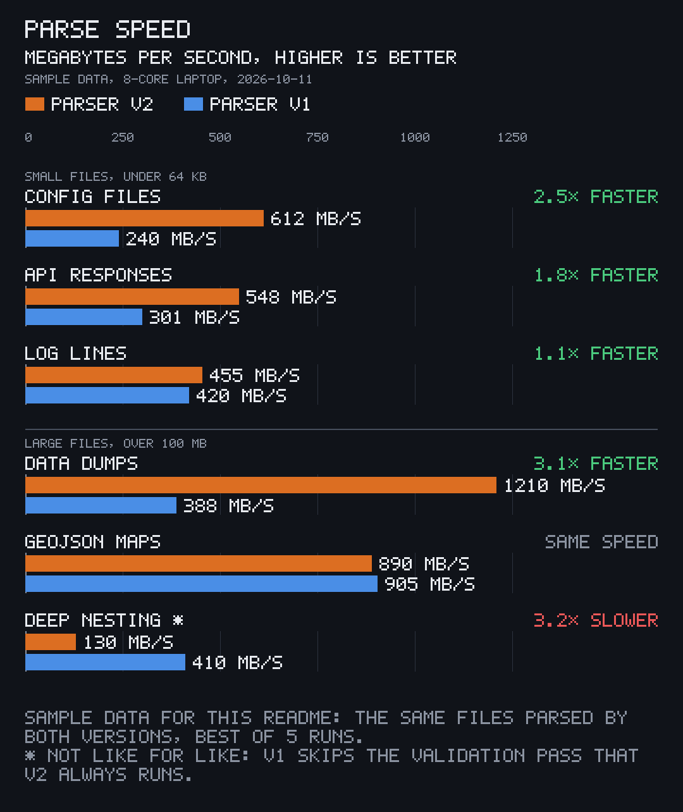
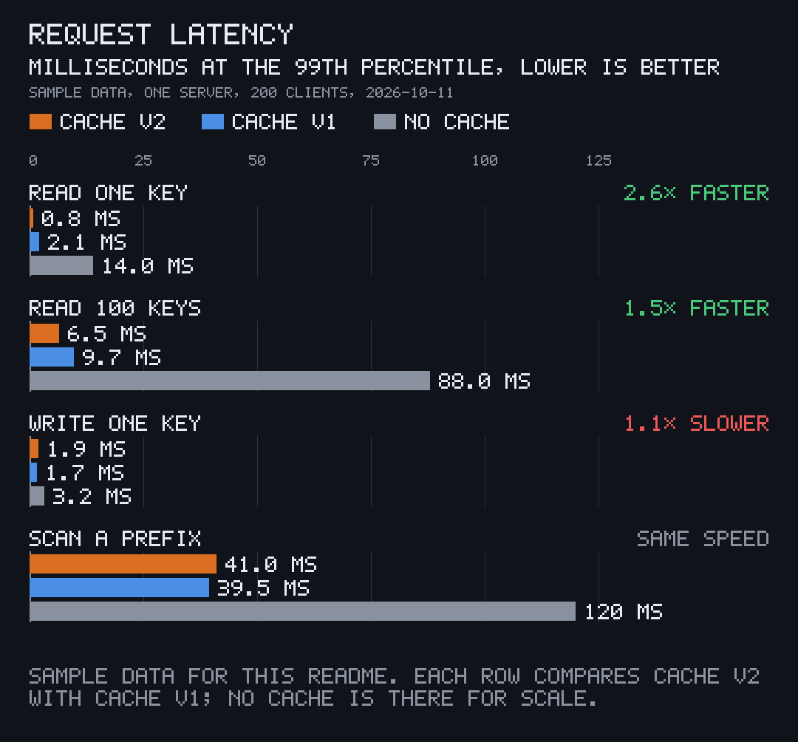
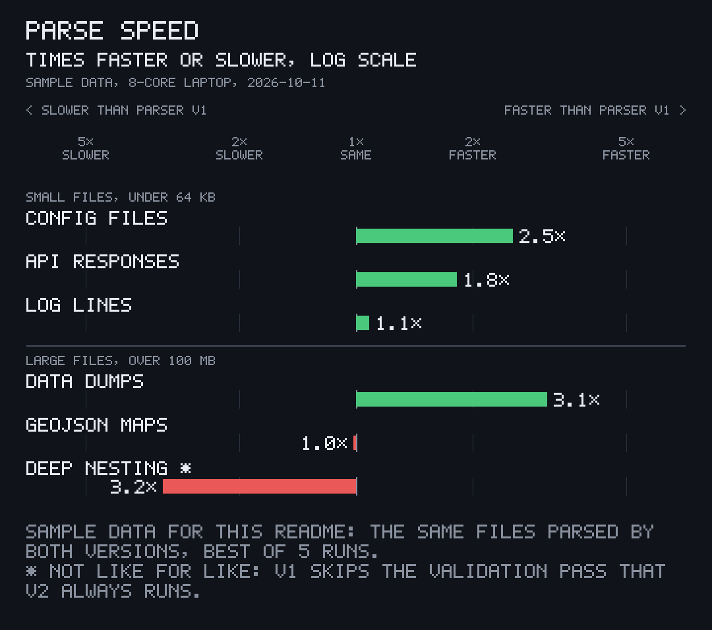
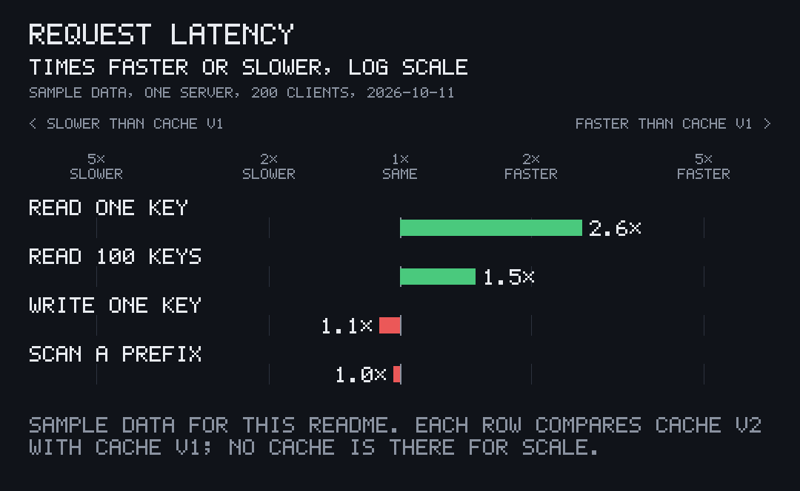
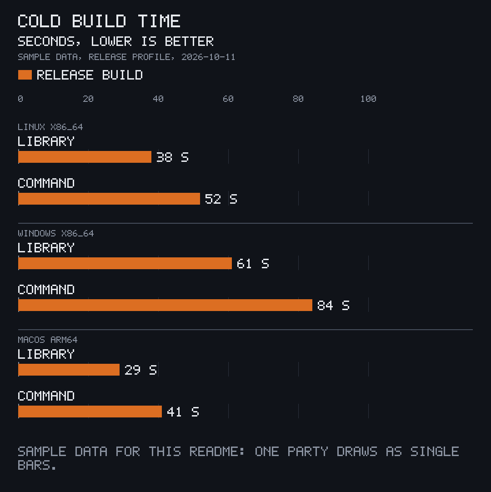
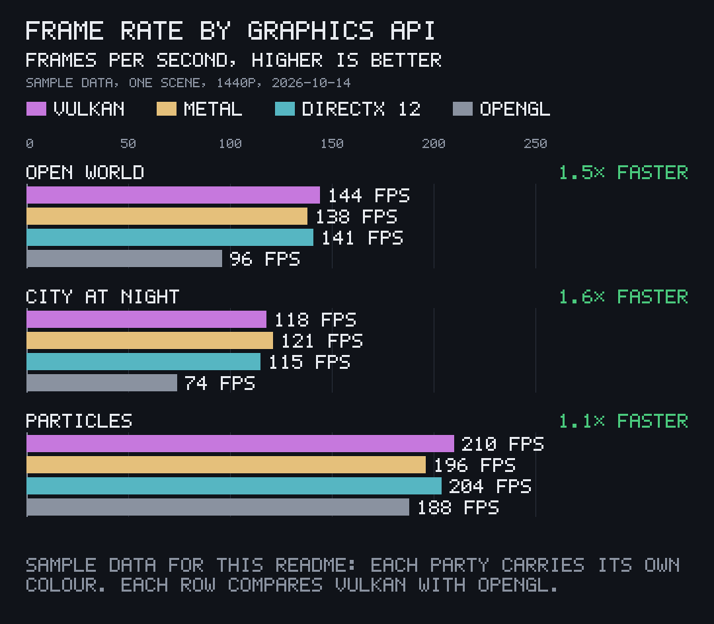
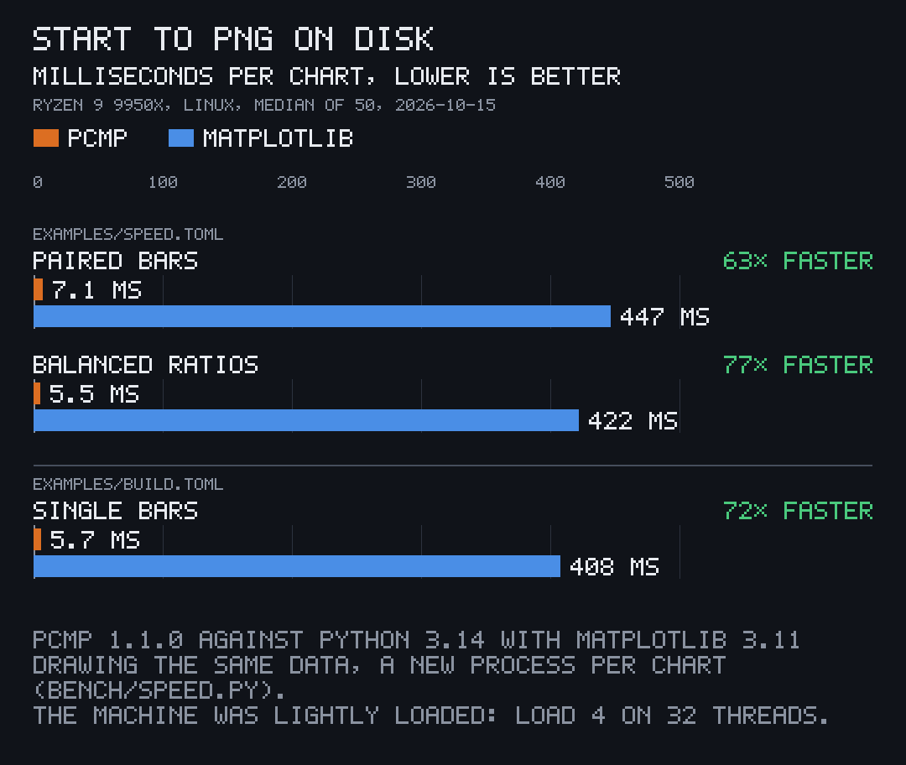
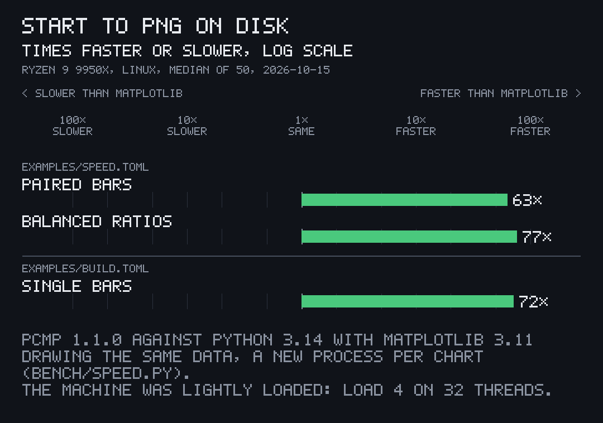

<p align="center"></p>

# pito-compare

[](https://github.com/gmrdad82/pito-compare/actions/workflows/ci.yml) [](https://github.com/gmrdad82/pito-compare/tags)

pito-compare draws benchmark comparison charts as PNGs, part of [PITO MD](https://pitomd.com). You write the numbers in a small JSON or TOML file, and `pcmp` draws them as dark, crisp charts in a hand-drawn pixel font: two or more parties side by side on one axis, how many times faster or slower one is than another, or plain bars. A chart takes 5 to 7 ms from start to PNG on disk, 63 to 77 times faster than matplotlib drawing the same data.

## At a glance

| | pcmp |
|---|---|
| Time per chart, start to PNG on disk | **5.7 ms** single bars, **5.5 ms** balanced ratios, **7.1 ms** paired bars |
| Against matplotlib 3.11, same data | **63× to 77× faster** (408 to 447 ms per chart) |
| Peak memory | **12.9 MB** (matplotlib: 82.5 MB) |
| Binary | **1.2 MB** (1,225,248 bytes, Linux x86_64, release profile, stripped) |
| Code | **1,271** non-blank lines of Rust, canvas, pixel font and charts included |
| Dependencies | **5** direct (png, serde, serde_json, toml, and clap for the command line); 40 crates in all, 27 for the library without clap |
| Release build from clean | **21.6 s** |
| Needs to run | nothing: one binary, no Python, no plotting library, no fonts on the system |

Measured on 2026-10-15 on an AMD Ryzen 9 9950X (32 threads) under Linux, with Rust 1.97.1, on a lightly loaded machine (load 4 on 32 threads); times are the median of 50 runs, a new process per chart. [How it was measured](#speed).

## Install and first use

pcmp runs on Linux (x86_64), Windows (x86_64) and macOS (Apple Silicon). Each [release](https://github.com/gmrdad82/pito-compare/releases/latest) carries a binary for all three, with a `SHA256SUMS` file.

**Linux:**

```
v=$(basename "$(curl -fsSLo /dev/null -w '%{url_effective}' https://github.com/gmrdad82/pito-compare/releases/latest)")
mkdir -p ~/.local/bin && curl -fsSL "https://github.com/gmrdad82/pito-compare/releases/download/$v/pcmp-$v-linux-x86_64.tar.gz" | tar -xz -C ~/.local/bin pcmp
```

**macOS:**

```
v=$(basename "$(curl -fsSLo /dev/null -w '%{url_effective}' https://github.com/gmrdad82/pito-compare/releases/latest)")
mkdir -p ~/.local/bin && curl -fsSL "https://github.com/gmrdad82/pito-compare/releases/download/$v/pcmp-$v-macos-arm64.tar.gz" | tar -xz -C ~/.local/bin pcmp
```

On Linux and macOS, `~/.local/bin` needs to be on your `PATH`.

**Windows** (PowerShell):

```
$v = (Invoke-RestMethod https://api.github.com/repos/gmrdad82/pito-compare/releases/latest).tag_name
Invoke-WebRequest "https://github.com/gmrdad82/pito-compare/releases/download/$v/pcmp-$v-windows-x86_64.zip" -OutFile "$env:TEMP\pcmp.zip"
Expand-Archive "$env:TEMP\pcmp.zip" "$env:LOCALAPPDATA\pcmp" -Force
[Environment]::SetEnvironmentVariable('Path', [Environment]::GetEnvironmentVariable('Path', 'User') + ";$env:LOCALAPPDATA\pcmp", 'User')
```

Open a new terminal afterwards, so it sees the new `PATH`.

**From source**, on any of the three, with Rust 1.97 or newer:

```
cargo install --locked --git https://github.com/gmrdad82/pito-compare --tag vX.Y.Z pito-compare
```

Replace `vX.Y.Z` with a [tag](https://github.com/gmrdad82/pito-compare/tags). pcmp needs nothing else to run.

**First chart:** save this as `demo.toml`,

```toml
title = "PARSE SPEED"
unit = "MEGABYTES PER SECOND"
better = "higher"
suffix = " MB/S"
parties = [{ name = "PARSER V2" }, { name = "PARSER V1" }]
rows = [
  { label = "CONFIG FILES", values = [612, 240] },
  { label = "LOG LINES", values = [455, 420] },
  { label = "DATA DUMPS", values = [1210, 388] },
]
```

then draw it:

```
$ pcmp demo.toml --out charts
charts/demo-paired.png
charts/demo-ratio.png
```

## The charts

Every chart below is drawn by pcmp from a file in [examples/](examples/) or [bench/](bench/); the examples' numbers are made up, the bench's are measured. All of them share one dark look, 1080 px wide, so charts from different runs and projects sit side by side; the party colours are yours to pick.

### Paired bars

Every party's value on one shared linear axis from zero, the value beside each bar, and per row how many times faster or slower the first party is than the one it is compared with. Rows fall under group headings, a row can carry a mark such as `*` or `†`, and notes under the chart explain them.



### Three or more parties

Up to 12 parties on the same axis. `versus` names the one the first party's tags compare with, so a third party can stand there for scale; `better = "lower"` turns the axis for times and latencies.



### Balanced ratios

1× in the middle, slower to the left and faster to the right on a symmetric log scale, so 3× slower is as long as 3× faster. pcmp draws it next to the paired bars for any data with two or more parties.





### Single bars

One party's values, when there is nothing to compare. `--kind bars` with several parties draws one chart per party.



### Your colours

A party's `colour` is any `#RRGGBB` or one of the chart's roles (`ours`, `theirs`, `dim`, `text`, `faster`, `slower`); the legend and the bars follow it.



### Never a wrong chart

Any character the font can't draw, an unknown key, a negative value or text too long for its line is refused with one line naming the file and the field, and no PNG is written:

```
$ pcmp bad.toml
pcmp: bad.toml: groups[0].rows[0].values holds -612: values are finite and zero or more
```

### A library too

The same charts from data built in Rust, with no command line and no clap ([the library](#the-library)).

## Speed

pcmp draws its own benchmark. [bench/speed.py](bench/speed.py) times pcmp drawing each chart kind, a new process per chart, 50 runs each, and takes the median; then it times Python 3.14 with matplotlib 3.11 drawing the same data as a similar dark 1080 px chart ([bench/matplotlib_chart.py](bench/matplotlib_chart.py)), the same way. [bench/pcmp-vs-matplotlib.toml](bench/pcmp-vs-matplotlib.toml) holds the numbers it printed, and pcmp drew them:





Most of matplotlib's time is Python and its import, but not all: in one run, drawing and saving after the import took 129 to 162 ms per chart, over twenty times pcmp's whole run. The matplotlib chart is the plainer of the two (no tags, no pixel font), which favours it. Peak memory was 12.9 MB for pcmp and 82.5 MB for matplotlib. The machine was lightly loaded while it ran (load 4 on 32 threads). To run it yourself, with matplotlib installed:

```
cargo build --release
python3 bench/speed.py
```

## What it is

Benchmark results read best as a picture, and a picture that looks the same every time. pito-compare is the chart drawer of [pito-codecs](https://github.com/gmrdad82/pito-codecs)' benchmarks made into a tool ([INSPIRATION.md](INSPIRATION.md)), with its exact look: the colours, the 5x7 pixel font, 1080 px wide. There is no plotting library: the canvas, the font and the PNG writer are a few hundred lines of Rust, so a chart is drawn the same, pixel for pixel, on every machine. pcmp's tests draw every chart in this README and compare it with the image here.

## Part of PITO MD

pito-compare is one of the open tools of [PITO MD](https://pitomd.com), built for speed and used across its projects:

- [pito-codecs](https://github.com/gmrdad82/pito-codecs): fast H.264, H.265, AAC and MP4 in pure Rust; its benchmark charts are where pito-compare's look comes from.
- [prec](https://github.com/gmrdad82/prec): exact, deterministic recordings of terminal apps; it recorded the clip at the top of this page.
- [pconv](https://github.com/gmrdad82/pconv): video deliveries and README GIFs in one short command; it made that clip a GIF.

## Use

```
pcmp <DATA> [--out DIR] [--kind all|paired|ratio|bars]
```

- `DATA` is a `.json` or `.toml` file (any other name is read as JSON when it starts with `{`, else as TOML).
- `--out` is the folder the PNGs go to, made if missing; the current folder by default.
- `--kind all` (the default) draws single bars for one party, and the paired and ratio charts for two or more. `paired`, `ratio` and `bars` draw one kind; `bars` with several parties draws one chart per party.

Each chart is written to `DIR/<the data file's name>-<kind>.png`, overwriting one already there (never through a symlink), and its path printed on its own line: `speed-paired.png`, `speed-ratio.png`, `build-bars.png`, or `speed-bars-parser-v2.png` per party.

### Exit codes

- `0`: every chart was drawn.
- `1`: the data file couldn't be read or drawn, or a PNG couldn't be written, with one line on stderr starting `pcmp: ` that names the file and, where it can, the field, line and column.
- `2`: the command line is wrong. pcmp answers the way clap-based tools do: `error: …`, the usage line and `For more information, try '--help'.`

## The data format

```toml
title = "PARSE SPEED"
unit = "MEGABYTES PER SECOND"
better = "higher"
subtitle = "SAMPLE DATA, 8-CORE LAPTOP"
date = "2026-10-11"
suffix = " MB/S"
notes = ["* NOT LIKE FOR LIKE: V1 SKIPS THE VALIDATION PASS."]

[[parties]]
name = "PARSER V2"

[[parties]]
name = "PARSER V1"

[[groups]]
name = "SMALL FILES"
rows = [
  { label = "CONFIG FILES", values = [612, 240] },
  { label = "DEEP NESTING", values = [130, 410], mark = "*" },
]
```

The same in JSON is an object with the same keys: `{"title": "PARSE SPEED", "better": "higher", "parties": [{"name": "PARSER V2"}, …], …}`. [examples/](examples/) has a TOML and a JSON file of each shape.

| Key | Required | What it is |
|---|---|---|
| `title` | yes | The chart's title, at most 41 characters. |
| `unit` | no | What the values measure; the chart adds "HIGHER IS BETTER" or "LOWER IS BETTER". |
| `better` | yes | `"higher"` or `"lower"`: which way is better, so which side counts as faster. |
| `subtitle`, `date` | no | The small line under the unit, such as the machine and the date, joined with a comma. |
| `parties` | yes | Who is compared, in the order their bars are drawn, one to 12. Each has a `name` and an optional `colour`. |
| `versus` | no | The name of the party the first one is compared with; the second party by default. |
| `rows` | one of the two | The rows, with no group headings. |
| `groups` | one of the two | Groups of rows, each with an optional `name` drawn as a heading and its `rows`. |
| `notes` | no | Lines under the chart, wrapped to its width. |
| `suffix` | no | Written after each value, such as `" FPS"` or `"×"`. |
| `decimals` | no | Decimals for each value, 0 to 6. By default one below 100 and none from 100 up. |
| `words` | no | `{ better = "FASTER", worse = "SLOWER", same = "SAME SPEED" }`, the words of the tags and the ratio chart. |

Each row has a `label`, its `values` (one per party, zero to 1e15) and optionally a `mark` written after the label, `texts` to print in place of the values (one per party), and a `ratio` to use in place of the one the values give.

A party's `colour` is `#RRGGBB` or one of the chart's roles: `ours` (orange, the first party's default), `theirs` (blue, the second's), `dim` (grey, the third's), `text` (white, the fourth's), `faster` (green) and `slower` (red).

How the comparison reads: with `better = "higher"`, the first party is `first / versus` times faster; with `"lower"`, `versus / first`. A row whose ratio rounds to 1.0 says "SAME SPEED". The ratio chart needs both compared values above zero, or a `ratio`.

The chart font draws A to Z (lower case is drawn in capitals), 0 to 9, space and `. , : ; - + / ( ) % = < > ' _ | × * †`. Any other character, an unknown key, a value that is negative, not a number or above 1e15, a ratio outside 1e-15 to 1e15, more than 12 parties, or text too long for its line is refused with the field it is in, so a chart never comes out wrong.

### The library

```toml
[dependencies]
pito-compare = { git = "https://github.com/gmrdad82/pito-compare", tag = "vX.Y.Z", default-features = false }
```

```rust
use pito_compare::{Better, Chart, Group, Kind, Row};

let mut chart = Chart::new("DECODE SPEED", "FRAMES PER SECOND", Better::Higher, &["OURS", "THEIRS"]);
chart.suffix = " FPS".into();
chart.groups.push(Group { name: "CPU".into(), rows: vec![Row::new("H.264 1080P", &[412.0, 298.0])] });
for (kind, canvas) in pito_compare::render(&chart, Kind::All)? {
    canvas.save(format!("decode-{kind}.png").as_ref())?;
}
```

`Chart::load` and `Chart::parse` read the data format above; `paired`, `ratios` and `bars` draw one chart each and return a `Canvas`, which `png()` encodes and `save` writes. `default-features = false` leaves out the command line and its clap.

## Contributing

Issues are welcome at [github.com/gmrdad82/pito-compare/issues](https://github.com/gmrdad82/pito-compare/issues): a chart that comes out wrong, with the data file that draws it, or an idea for a chart pcmp should draw. Pull requests aren't taken. Please read the [code of conduct](CODE_OF_CONDUCT.md) first, and report a security issue privately as [SECURITY.md](SECURITY.md) says.

## Build and test

```
cargo build --release
bin/gate
```

`bin/gate` runs what CI runs on Linux, Windows and macOS: ShellCheck where it is installed, rustfmt, clippy with warnings as errors, and the tests, which include drawing the examples and comparing them pixel for pixel with the README's images. `bin/images` draws those again after a change to the look, and `bin/docs-bundle` builds the documentation pages from `docs/pages`, the command line's help, `cargo doc` and this CHANGELOG; a tag attaches them to its release as `docs-vX.Y.Z.tar.gz`. `python3 bench/speed.py` measures pcmp against matplotlib ([Speed](#speed)); nothing else needs Python. CI runs the gate on all three on every push and nightly, and builds the Linux release binary; a tag builds the three release binaries. On Windows it runs in Git Bash. The README's clip is a prec shot in `render/terminal.toml`, made a GIF by pconv ([NOTICE](NOTICE)).

## Licence


The code is MIT licensed ([LICENSE](LICENSE)), © Catalin Ilinca. The pito-compare, pcmp and PITO MD names and their logos are © Catalin Ilinca, all rights reserved, and are not covered by the MIT licence ([TRADEMARKS.md](TRADEMARKS.md)).
